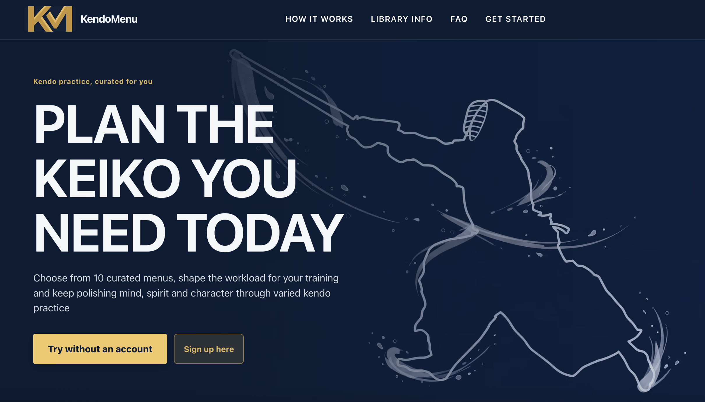

# KendoMenu 🥋: Plan the keiko you need today.

[](https://github.com/JavierMarro/kendo-menu/actions/workflows/ci.yml)
[](LICENSE)

KendoMenu is a free, open-source web app for planning kendo practice. Choose from 10 curated
training menus, shape the workload for your session, keep practice notes, or create a menu of your
own. Use it as a guest in your browser or sign in with Google to save a dashboard online.



## Use it

Open [kendomenu.com](https://www.kendomenu.com/app) and choose **Try without an account** to start
in guest mode. Your dashboard is saved in this browser and works offline. You can also sign in with
Google to use an online account dashboard across devices; account edits are saved only when you
choose **Save to account**. Eligible new accounts can choose once whether to copy their guest
dashboard. The guest copy stays on the original device either way.

KendoMenu is a responsive web app and installable PWA. There is no native mobile app.

## Quick start

You need Node.js **24.x** and pnpm **11.22.0**. Guest mode needs no database, API server, or auth
configuration.

```sh
corepack enable pnpm
pnpm install --frozen-lockfile
pnpm dev
```

Open `http://localhost:5173`.

For account and API development, use a non-production Neon branch and follow the
[managed-account development guide](docs/MANAGED_ACCOUNT_WEB.md). Do not use production credentials
or data for local development.

Check your changes with:

```sh
pnpm check
pnpm test:e2e
pnpm test:e2e:pwa
```

`pnpm verify:full` runs the release checks, the production-preview browser suite, and the PWA suite.
Database integration tests use only a guarded local `kendomenu_test` database; never use Neon or a
development database as `TEST_DATABASE_URL`.

## What the app does for the practitioner

- **Curated practice menus.** Browse 10 kendo training sessions for different practice goals and
  experience levels.
- **Session planning.** Add a menu to your dashboard, adjust repetitions or duration for the day,
  and keep notes about your practice.
- **Custom menus.** Build and edit your own ordered practice session.
- **Mitori room.** Explore curated videos in Mitori, Documentaries, and Kata, alongside Resources
  and a searchable Glossary. Mark videos as Seen and clear the mark later when you want to revisit
  one; marks are saved in this browser only. Videos load from YouTube only when opened and may
  include YouTube ads.
- **Guest or Google account.** Guests keep data in their browser. Account dashboards are stored
  online and require an explicit save. Guest and account data remain separate.
- **Installable web app.** Use KendoMenu in a desktop or mobile browser, or install the PWA where
  your browser supports it.

## How a practice menu works

A curated menu describes an ordered session of kendo activities and exercises. Adding one to your
dashboard creates a session-specific copy, where you can adjust repetitions or duration and attach
notes without changing the curated library. Custom menus use the same activity structure and can be
edited on your dashboard.

## Workspace

This is a pnpm monorepo. The responsive web app is the complete product surface.

| Path              | Role                                                  | Run or check                                  |
| ----------------- | ----------------------------------------------------- | --------------------------------------------- |
| `apps/web`        | React and Vite application, responsive UI, and PWA    | `pnpm dev`, `pnpm check:web`, `pnpm test:e2e` |
| `apps/api`        | Node 24 and Elysia API with PostgreSQL persistence    | `pnpm dev:api`, `pnpm check:api`              |
| `packages/domain` | Training contracts, validation, and curated menu data | `pnpm check:domain`                           |
| `packages/store`  | Zustand dashboard state and persistence boundaries    | `pnpm check:store`                            |
| `packages/ui`     | Reserved for genuinely shared, platform-neutral UI    | —                                             |

## Documentation

| File                                                                                               | What it covers                                       |
| -------------------------------------------------------------------------------------------------- | ---------------------------------------------------- |
| [PRODUCT.md](PRODUCT.md)                                                                           | Product behavior and user journeys                   |
| [CONTEXT.md](CONTEXT.md)                                                                           | KendoMenu training and account terminology           |
| [docs/ARCHITECTURE.md](docs/ARCHITECTURE.md)                                                       | Package layout, contracts, and data flow             |
| [docs/MANAGED_AUTH_TRANSITION.md](docs/MANAGED_AUTH_TRANSITION.md)                                 | Approved managed-auth scope and transition jobs      |
| [docs/MANAGED_ACCOUNT_WEB.md](docs/MANAGED_ACCOUNT_WEB.md)                                         | Account setup and local development                  |
| [docs/MANAGED_GUEST_COPY.md](docs/MANAGED_GUEST_COPY.md)                                           | One-time guest dashboard copy behavior               |
| [docs/MANAGED_DASHBOARDS.md](docs/MANAGED_DASHBOARDS.md)                                           | Account dashboard API and database contract          |
| [`apps/web/.env.example`](apps/web/.env.example), [`apps/api/.env.example`](apps/api/.env.example) | Placeholder configuration templates                  |
| [AGENTS.md](AGENTS.md)                                                                             | Repository conventions and verification requirements |

## Contributing and security

Focused issues and pull requests are welcome. Keep credentials and private configuration out of
commits, screenshots, logs, and `.env.example` files. Read [AGENTS.md](AGENTS.md) before making code
changes; it describes the required checks and data-safety boundaries.

## License

Copyright (C) 2026 JavierMarro.

KendoMenu's original code is licensed under **GNU AGPL version 3 only** (`AGPL-3.0-only`); see
[LICENSE](LICENSE). Third-party dependencies and materials retain their own license terms.
